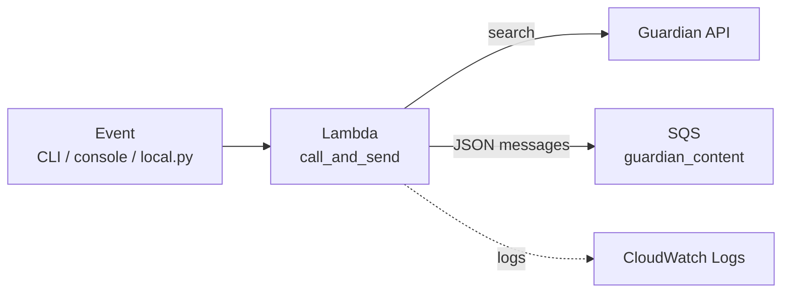

# Guardian News Pipeline

A serverless pipeline on AWS that searches the [Guardian Open Platform API](https://open-platform.theguardian.com/) for articles and publishes them as JSON messages to an SQS queue, ready for downstream consumers. The infrastructure is defined in Terraform, with remote state in a versioned, encrypted S3 bucket.

> **Status:** work in progress. The ingestion Lambda and queue work today; scheduling, a data lake in S3 and dbt models are on the [roadmap](#roadmap).

## Architecture



The Lambda takes a search term and an optional start date, calls the Guardian search API, keeps the ten most recent results, and sends each one to the queue as a separate message.

## Message format

```json
{
    "webPublicationDate": "2023-11-21T11:11:31Z",
    "webTitle": "Who said what: using machine learning to correctly attribute quotes",
    "webUrl": "https://www.theguardian.com/info/2023/nov/21/who-said-what-using-machine-learning-to-correctly-attribute-quotes"
}
```

## Tech stack

- **Python 3.12**: `requests` for the API, `boto3` for SQS
- **AWS**: Lambda (with a dependencies layer), SQS, IAM, CloudWatch Logs, S3 for Terraform state
- **Terraform**: AWS provider `~> 6.0`, S3 backend with native state locking
- **Quality**: pytest with coverage, black, bandit, all run through `make`

## Prerequisites

- Linux or WSL (Make and Bash are needed)
- Python 3.12
- Terraform 1.10 or later
- An AWS account, with the AWS CLI configured (`aws configure`)
- A free Guardian API key from the [Open Platform](https://open-platform.theguardian.com/access/)

## Local development

```bash
make all
```

This creates a virtual environment, installs the dev requirements, builds the Lambda layer dependencies into `dependencies/python`, then runs bandit, black and the unit tests with a coverage report. It needs no AWS access.

Other useful targets:

| Command | What it does |
| --- | --- |
| `make requirements` | Create the venv and install dependencies only |
| `make unit-test` | Run the tests without coverage |
| `make run-black` | Format the code |
| `make security-test` | Run bandit on `src/` |

## Deployment

Deployment has two Terraform configurations: a small one-off **bootstrap** that creates the state bucket, and the **main** configuration for the pipeline itself.

**1. Create the state bucket (once per AWS account)**

```bash
make bootstrap
```

This applies `terraform/bootstrap/`, which creates an S3 bucket for Terraform state with versioning, encryption and public access blocked. The bootstrap keeps its own state locally, as nothing remote exists yet.

> **Bucket already exists?** On a second machine or in a fresh clone of an account that is already bootstrapped, skip `make bootstrap` (it fails with `BucketAlreadyOwnedByYou`). Instead, create `terraform/backend.hcl` by hand with one line, `bucket = "<your-state-bucket-name>"`, then run `terraform -chdir=terraform init -backend-config=backend.hcl` in place of `make tf-init`.

**2. Initialise the main configuration**

```bash
make tf-init
```

This writes `terraform/backend.hcl` (gitignored) with the bucket name from the bootstrap output, then runs `terraform init` against it. To create the file by hand instead, put one line in it: `bucket = "<your-state-bucket-name>"`.

**3. Build the layer and deploy**

```bash
make requirements              # builds dependencies/ for the Lambda layer
terraform -chdir=terraform plan
terraform -chdir=terraform apply
```

This deploys, in `eu-west-2`:

- the Lambda `call_and_send`, with a layer for its dependencies
- the SQS queue `guardian_content`
- an IAM role allowing the Lambda to send to that queue and write CloudWatch logs

**Tear down:** `terraform -chdir=terraform destroy` removes the pipeline. The state bucket is managed by the bootstrap and protected with `prevent_destroy`, so it stays.

## Usage

### Invoke the deployed Lambda

From the AWS CLI:

```bash
aws lambda invoke \
  --function-name call_and_send \
  --cli-binary-format raw-in-base64-out \
  --payload '{"content": "machine learning", "api_key": "<your-key>", "date": "2025-01-01", "sqs_name": "guardian_content"}' \
  response.json
```

Or from the Lambda console, with a test event like this:

```json
{
    "content": "machine learning",
    "api_key": "<your-key>",
    "date": "2025-01-01",
    "sqs_name": "guardian_content"
}
```

`content`, `api_key` and `sqs_name` are required; `date` (`YYYY-MM-DD`) is optional. Check the results in the SQS console under **Send and receive messages → Poll for messages**.

### Run locally

Save your key in a `.env` file at the repo root:

```
API-KEY=<your-guardian-key>
```

Then run:

```bash
source venv/bin/activate
python local.py
```

It prompts for a search term, an optional start date (`dd-mm-yyyy`) and a queue name, then runs the same handler on your machine. It still sends to a real SQS queue, so your AWS credentials need access to it.

## Project layout

```
.
├── src/main.py              # Lambda handler: call the API, send to SQS
├── local.py                 # Run the handler from the command line
├── tests/
│   ├── test_main.py         # Unit tests (API and SQS mocked)
│   └── resources/           # Saved API response used by the tests
├── terraform/
│   ├── bootstrap/           # One-off: state bucket (local state)
│   ├── main.tf              # Providers and S3 backend
│   ├── lambda.tf, layer.tf  # Lambda function and dependencies layer
│   ├── sqs.tf, iam.tf       # Queue and permissions
│   └── vars.tf
├── requirements.txt         # Runtime dependencies
├── requirements-dev.txt     # Test, lint and security tools
└── Makefile
```

## Known limitations

- The API key is passed in the event. It will move to SSM Parameter Store so it never travels with the request.
- Only the first page of results (ten articles) is fetched per run, and there is no record of what was already sent, so repeated runs send duplicates.
- Some errors are printed rather than raised, so a failed send to SQS can still look like a successful Lambda run.
- The bootstrap's own state is local, so it exists only on the machine that ran `make bootstrap`. If it is lost, the bucket keeps working and can be brought back under Terraform with `terraform import`.
- Never delete the state bucket by hand: Terraform loses its record of every resource, and anything still deployed has to be removed manually or imported. The bootstrap protects the bucket with `prevent_destroy` and versioning, but neither stops a deletion from the console.

## Roadmap

- [x] Pinned dependencies, Python 3.12 runtime, Terraform version constraints
- [x] Bootstrap the state bucket in Terraform
- [ ] API key in SSM Parameter Store
- [ ] CI on GitHub Actions (tests, black, bandit, `terraform validate`)
- [ ] Scheduled runs with EventBridge, pagination, a watermark so only new articles are fetched, retries with backoff
- [ ] Dead-letter queue and CloudWatch alarms
- [ ] Consumer Lambda landing messages in S3 as a date-partitioned raw layer
- [ ] Athena and dbt models: staging, dimensions, facts and a coverage mart
- [ ] One analysis question answered with a chart